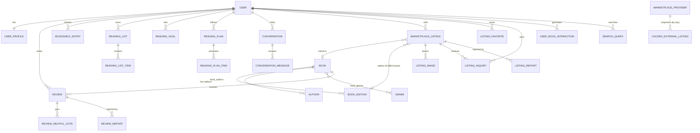

# Architecture

```
frontend (React 19 + Vite + TypeScript + Tailwind v4)
   │  same-origin /api and /uploads (Vite proxy in dev, or FastAPI serves dist/ in single-service mode)
   ▼
backend (FastAPI)
   api/            HTTP routes only: validation, auth checks, response shaping
   services/       catalogue import, book detail/comparison/offers, NL search, listings, uploads, reading plans
   repositories/   catalogue queries (search, filters, aggregates)
   recommender/    signals → content (TF-IDF/embeddings) + item-item CF + popularity → hybrid + evaluation
   marketplace/    provider adapters, identification, validation/dedup, pricing, quality, ranking
   agents/         LangGraph used-book workflow, intent agent, reading assistant, optional LLM layer
   integrations/   Open Library, Google Books, eBay Browse (all optional, cached, time-limited)
   security/       bcrypt hashing, signed session cookie, CSRF header check, security headers
   models/ + db/   SQLAlchemy 2 models, Alembic migrations, seed data
   ▼
SQLite (default) or PostgreSQL (DATABASE_URL)        local disk for uploads (UPLOAD_DIR)
```

Every external dependency is optional. With no keys and no internet the app still runs: local catalogue,
TF-IDF semantic search, hybrid recommendations, community marketplace, deterministic agents.

## Request flow examples

* **Book search** `GET /api/books` → `repositories.books.search_books` (SQL filters → lexical relevance → sort) → `BookSummary` with app vs external ratings kept separate.
* **Recommendations** `GET /api/recommendations` → `recommender.service.recommend_for_user` → cached `HybridRecommender` (refits automatically when ratings, interactions, preferences or the catalogue change) → items with reasons → `RecommendationEvent` rows for analytics.
* **Used-book search** `POST /api/marketplace/search-used-books/stream` → LangGraph `GRAPH.stream(...)` → NDJSON events (`step running/completed`, then `result`). See [MARKETPLACE_INTELLIGENCE.md](MARKETPLACE_INTELLIGENCE.md).

## Data model



Other tables: `external_cache` (provider response cache with expiry), `recommendation_events`,
`recommendation_evaluation_runs`, `audit_logs`.

### Design decisions (where the schema differs from the brief)

| Decision | Why |
|---|---|
| **Rating + Review merged** into `reviews` (rating required, body optional), unique `(user_id, book_id)` | A rating without text is just a review with no body. The unique constraint is what prevents duplicate ratings; re-rating updates the row. |
| **Book vs BookEdition** | Works (description, genres) live on `books`; ISBN/format/publisher/pages per edition on `book_editions` (unique ISBN-13). Listings link to an edition only when the seller gives an ISBN, so editions are never merged by title. |
| **Genres and subjects share `genres`** with a `kind` column | Curated genres appear in filters; imported subjects enrich content similarity without cluttering filters. |
| **Preferences as JSON on `user_profiles`** | Small, user-owned, always read together, never queried across users. |
| **`user_book_interactions` with a weight column** | One table for views, saves, dismissals, shelf changes; weights are documented in `models/social.py` and [RECOMMENDER.md](RECOMMENDER.md). |
| **Price stored as `Numeric(10,2)` + `currency` CHAR(3)** | Exact money arithmetic; currencies are never mixed without an explicit rate. |
| **`is_sample` / `is_demo` flags** | Seeded catalogue, demo users and sample listings are always distinguishable from real records (UI badges, evaluation exclusion). |
| **`token_version` on users** | Bumping it invalidates every session (logout everywhere, password change, suspension). |

### Constraints & deletion behaviour

* Check constraints: rating 1–5, price > 0, shipping ≥ 0, pages ≥ 0, goal target > 0.
* Unique: email, ISBN-13, (user, book) for reviews/shelf entries, (user, review) votes, (user, listing) favourites and reports, (list, book), (provider, external_id).
* Indexes on searched/filtered columns: titles, normalized titles, ISBNs, language, year, listing status+created_at, condition, city.
* Deleting a user cascades to their profile, reviews, shelf, lists, goals, plans, conversations, listings (+ images on disk), favourites, inquiries and interactions. Reports they filed are kept with `reporter_id = NULL`; audit log entries keep `actor_id = NULL`.
* Deleting a book cascades to editions, reviews and shelf entries; listings keep their own title/author and just lose the link (`SET NULL`).

### Migrations

Alembic (`backend/alembic/`), with `render_as_batch=True` so ALTER operations work on SQLite as well as PostgreSQL.
`python -m app.cli init-db` applies migrations; `alembic revision --autogenerate -m "..."` creates new ones;
`alembic check` verifies models and migrations are in sync.
