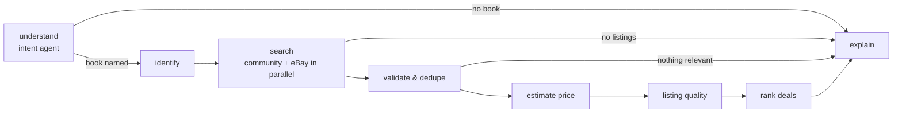

# Second-hand book intelligence

Code: `backend/app/agents/used_book_graph.py` (LangGraph) and `backend/app/marketplace/*` (deterministic logic).

## Workflow

Typed state (`UsedBookState`) carries the request, parsed params, identified book, provider summaries, raw and
validated listings, exclusions, estimate, per-listing verdicts, quality reports, ranking, errors and a trace.
Each node is wrapped to emit a `running` event (LangGraph custom stream), time itself, log, and turn exceptions
into an `errors` entry so one failing step degrades the result instead of crashing it. The streaming endpoint
forwards these events, so the UI shows a step only when it is really running or done.

Only two places may use an LLM, both optional and validated:

| Node | LLM use | Guard |
|---|---|---|
| understand | Fill title/author/budget/condition the rules missed | Every title word, budget number and condition must appear in the user's own text |
| explain | Rephrase the summary | Every number in the output must occur in the structured facts; no URLs; length cap. Otherwise the deterministic text is used and the response says so |

All other steps are plain Python. The UI shows which mode produced each step and the summary.

## Agents

**Intent** (`agents/intent.py`): ISBN detection (checksum-validated), budget vs. asking price (“under ₹500” vs
“is ₹300 fair”), currency, minimum condition, pickup/shipping, city, edition, intent type, and the title (quoted
text → longest catalogue title contained in the request → filler stripping). If no book can be found it routes to
a clarification answer.

**Identification** (`marketplace/identify.py`): confidence 1.00 for an ISBN in the catalogue; 0.95 for an ISBN
resolved via Open Library/Google Books (then imported); fuzzy title(+author) match score for catalogue matches
(accepted ≥ 0.80); 0.85 × score for Open Library title matches. Ambiguity is flagged when a different work scores
within 0.05, and candidates are returned.

**Search** (`marketplace/providers.py`): providers run in a thread pool with a shared 12 s deadline; each has its own
DB session; failures/timeouts are recorded per provider and never discard other providers' results. eBay results are
snapshotted in `cached_external_listings` with their retrieval time.

**Validation & dedup** (`marketplace/validate.py`): match classes *exact* (ISBN is a known edition), *same work*
(linked to the same catalogue book; edition unknown/different), *approximate* (strong title + author match) and
*unmatched* (excluded with a reason). Companion products (summaries, workbooks, bundles, merchandise) are excluded.
Exact duplicates are dropped; same-seller/same-title/same-price/same-condition listings are flagged as probable
duplicates. Missing optional fields add issues but never remove a listing.

**Price intelligence** (`marketplace/pricing.py`):
1. Comparables in the target currency only (other currencies excluded unless `FX_RATES_JSON` gives a rate).
2. Narrowest tier with ≥ 3 listings: exact → +same work → +approximate.
3. Condition-normalised to a “Good” equivalent with heuristic factors (New 1.30, Like New 1.15, Very Good 1.05,
   Good 1.00, Acceptable 0.85, Poor 0.65), weighted by recency (half-life 60 days) and sample status (×0.5).
4. Weighted 25th/50th/75th percentiles, scaled back to the requested condition; with < 5 comparables the band is
   widened to the observed min/max ±10%.
5. Fewer than 3 comparables: a rule-of-thumb band from a **user-supplied** new-copy price (e.g. Good = 35–55%),
   labelled low confidence; otherwise **“Insufficient data to estimate reliably.”**

Confidence (documented formula): `tier base (0.50 exact / 0.40 same work / 0.25 approximate) + 0.35 × min(n,10)/10
+ 0.15 if IQR/median < 0.35 (0.05 if < 0.6) − 0.2 × share of sample listings` → high ≥ 0.75, medium ≥ 0.5, low.
Per-listing verdicts use **leave-one-out** estimates so a listing is never compared with itself. The output always
states that it describes asking prices, not completed sales.

**Listing quality** (`marketplace/quality.py`), 0–100: completeness 30, stated condition 15, photos 15 (8 for a
stock image), identification 15, freshness 10, seller history 10, shipping known 5. Flags are neutral (“No photos of
the actual copy”, “Price is far below comparable listings: confirm condition and details before paying”) and never
accuse sellers. Photos and seller history are not treated as proof of authenticity.

**Deal ranking** (`marketplace/ranking.py`): `0.30 value + 0.20 condition + 0.20 quality + 0.15 edition match +
0.10 delivery fit + 0.05 freshness`. Value compares total known cost with the condition-adjusted typical price.
Price competitiveness is kept apart from quality: unusually cheap flagged listings have value capped at 0.6 and
listings with quality < 40 are multiplied by 0.8, so a suspicious bargain is not automatically first.
Results are grouped: meets all constraints / near match (one soft miss, e.g. ≤ 15% over budget or one condition
grade lower) / other. Unknown shipping marks the total as incomplete.

## Data honesty rules implemented

* Listings come only from the community database or a configured provider; seeded listings are `is_sample` and badged.
* Provider-returned URLs only (eBay URLs must be `https://`); internal listings link to their own page.
* No shipping cost, availability or price is invented; unknowns are shown as unknown.
* Editions are never merged on title alone; different ISBNs are flagged.
* External listings outside India are flagged “shipping to India not confirmed”.

## eBay notes

Free developer keys (developer.ebay.com). Sandbox returns test data only. Production keys need Browse API access
under eBay's terms; results are asking prices on `EBAY_MARKETPLACE_ID` (default `EBAY_US`). Without keys the
provider is reported as “not configured” and everything else keeps working. No scraping is performed anywhere.
